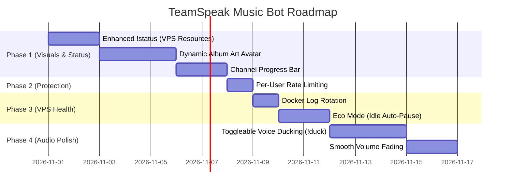

# 🗺️ Project Roadmap & Feature Enhancements

A structured improvement roadmap for the **TeamSpeak 3 Spotify Music Bot**, specifically designed to operate efficiently within an **Oracle Cloud Free Tier VPS (1 vCPU, 1 GB RAM, 24/7 Uptime)** while maximizing user experience and public channel stability.

---

## 📊 Feasibility & Resource Budget (1 GB RAM Target)

The entire bot stack currently operates comfortably within ~280 MB RAM. Every enhancement in this roadmap is evaluated against memory, CPU, and network impact:

| Feature | Category | Memory Cost | CPU Cost | Priority | Status |
|---|---|---|---|---|---|
| **Comprehensive `!status` (VPS + App)** | Diagnostics | < 50 KB (`psutil`) | Negligible (on command) | High | 📋 Planned |
| **Dynamic Album Art Avatar** | Visuals | ~1–2 MB (transient) | Low (once per track) | High | 📋 Planned |
| **Channel Description Progress Bar** | Visuals | < 500 KB | Very Low (async timer) | High | 📋 Planned |
| **Toggleable Voice Ducking (`!duck`)** | Audio Quality | Zero | Very Low | High | 📋 Planned |
| **Eco Mode (Idle Auto-Pause)** | VPS Health | Lowers RAM & CPU | Saves CPU / Network | High | 📋 Planned |
| **Docker Log Rotation** | VPS Health | Saves Disk Space | Zero | High | 📋 Planned |
| **Per-User Command Rate Limiting** | Protection | < 100 KB (dictionary) | Zero | Medium | 📋 Planned |
| **Smooth Volume Fading** | Audio Quality | Zero (audio curve) | Very Low | Medium | 📋 Planned |
| **Lyrics Fetcher (`!lyrics`)** | Utility | < 1 MB | Very Low | Low | 💡 Idea |
| **24/7 Backup Radio Stream** | Playback | ~15–20 MB (ffmpeg pipe)| Low | Low | 💡 Idea |

---

## 📈 Phase 1: Real-Time Diagnostics & High-Impact Visuals

### 1.1 Comprehensive Real-Time `!status` Report
* **Concept:** Expand the existing `!status` command to report live VPS hardware resource utilization, TeamSpeak connection health, and Spotify streaming metrics in a clean BBCode layout.
* **Example Output in TeamSpeak Chat:**
  ```text
  📊 [b]Bot & System Health Status[/b]
  ──────────────────────────────────────
  🖥️ [b]System Resources (Oracle Cloud):[/b]
  • CPU Usage: 8.4%
  • RAM Usage: 278 MB / 1024 MB (27.1%)
  • Swap Usage: 45 MB / 2048 MB (2.2%)
  • Uptime: 3 days, 14 hours

  🎙️ [b]TeamSpeak 3 Connection:[/b]
  • Status: Connected (Ping: 19ms)
  • Channel: 🎵 Music & Chill (Humans: 4)
  • Nickname: ☠ ʀᴀɢᴇ ʙᴏᴛ ☠

  🎵 [b]Spotify Connect State:[/b]
  • Account: Paired (mohammed-Araf)
  • Device: RageBot (go-librespot)
  • Playback: Playing (Vol: 40% | Max: 80%)
  • Voice Ducking: [color=#28a745]ON[/color] (Dips 30% during speech)
  ──────────────────────────────────────
  ```
* **Technical Implementation:**
  * Uses lightweight `psutil` or Linux `/proc/stat` and `/proc/meminfo` (costs zero extra background memory).
  * Queries `go-librespot` local status on `http://127.0.0.1:3678/status`.
  * Formatted with BBCode colors and bold styling.

---

### 1.2 Dynamic Album Art Avatar
* **Concept:** When a song starts playing, fetch the album art thumbnail (300×300 JPEG) and set it as the bot's TeamSpeak avatar. When paused or stopped, revert to the default bot icon.
* **Technical Implementation:**
  1. Retrieve `item.album.images` from Spotify Connect state (`go-librespot` event or API).
  2. Download the smallest image (~20–40 KB) using `aiohttp` into memory (`io.BytesIO`).
  3. Upload the avatar to TeamSpeak via ClientQuery command `clientupdate client_flag_avatar=...`.
* **Why it matters:** The bot visually mirrors the album art right in the TeamSpeak channel tree, giving it a state-of-the-art look.

---

### 1.3 Live Channel Description Progress Bar with Ducking Status
* **Concept:** Dynamically update the bot's TeamSpeak description or the channel topic with live BBCode progress indicators and current toggles.
* **Example Preview in TeamSpeak:**
  ```text
  [b]▶ Now Playing:[/b] [color=#1DB954]Starboy[/color] - The Weeknd
  [b]Album:[/b] Starboy
  [font=Courier New][color=#1DB954][████████░░░░░░░░░░░░][/color][/font] [b]1:42 / 3:50[/b]
  [b]Volume:[/b] 40%  |  [b]Ducking:[/b] [color=#28a745][b]ON[/b][/color]
  [i]Requested via Spotify Connect[/i]
  ```
* **Technical Implementation:**
  * Background asyncio task running every 5 seconds while playback is active.
  * Sends `clientedit client_description=...` to ClientQuery API.
  * Cleans up or shows `⏸️ Paused` when playback stops.

---

## 🛡️ Phase 2: Access & Protection (Role-Governed)

> [!NOTE]
> **Design Decision:** Because music playback is strictly restricted to trusted users holding designated server groups (`ALLOWED_SERVER_GROUPS`), voting mechanisms like `!voteskip` are **not needed**. Trusted role-holders manage playback directly.

### 2.1 Per-User Command Throttling (Anti-Flood Protection)
* **Concept:** Protect the internal ClientQuery telnet socket from flooding or accidental macro spam.
* **Logic:**
  * Maintain an in-memory dictionary tracking `{client_uid: [timestamp1, timestamp2, ...]}`.
  * Allow a maximum of 3 commands per 5 seconds per user.
  * If exceeded, whisper the user: `⏳ Slow down! Please wait 2 seconds before sending another command.`
  * Keeps the bot responsive and immune to input jamming.

---

## ⚡ Phase 3: 24/7 Stability & Oracle 1GB VPS Health

Designed specifically for 24/7 hosting on minimal hardware without manual server maintenance.

### 3.1 "Eco Mode" (Idle Sleep / Auto-Pause)
* **Concept:** Don't waste Spotify streaming bandwidth and CPU cycles when no humans are in the music channel.
* **Logic:**
  * Hook the `clientmoved` and `clientleftview` events in ClientQuery.
  * Count human clients in the bot's channel.
  * If `human_count == 0` for $\ge 5$ minutes:
    1. Automatically issue pause.
    2. Post log: `[ECO MODE] Channel empty. Audio paused to conserve VPS resources.`
  * When the first person joins the channel again:
    1. Announce: `👋 Welcome! Type !play or !resume to start listening.`

### 3.2 Automated Docker Log Rotation
* **Concept:** Prevent Docker container stdout/stderr logs from filling the 40GB VPS root disk over months of uptime.
* **Configuration (in `docker-compose.yml`):**
  ```yaml
  logging:
    driver: "json-file"
    options:
      max-size: "10m"
      max-file: "3"
  ```
* Caps total log footprint at 30 MB maximum per container permanently.

### 3.3 Memory Guard & Inactive Maintenance Window
* **Concept:** Long-running Linux X11/PulseAudio/Qt client processes can experience slow memory creep over weeks.
* **Logic:**
  * Controller monitors container memory footprint via `/sys/fs/cgroup/memory.current` (or `psutil`).
  * If container memory exceeds 450 MB **and** no active playback has occurred for 30 minutes between 03:00 AM – 05:00 AM server time, automatically trigger a graceful 3-second internal process restart.

---

## 🎧 Phase 4: Audio Polish & Toggleable Ducking

### 4.1 Toggleable Voice Ducking (`!duck` / `!ducking`)
* **Concept:** Automatically decrease music volume by 30% when someone speaks in the channel so users don't have to shout over loud tracks.
* **Feature Controls:**
  * **Command:** `!duck` (toggles on/off) or `!duck on` / `!duck off`.
  * **Permission:** Allowed Role / Admin.
  * **Chat Notification:**
    * `🎙️ Voice ducking enabled: Music will lower when someone speaks.`
    * `🔇 Voice ducking disabled: Music volume remains constant.`
  * **BBCode Display:** Reflected live in the bot description:
    * `[b]Ducking:[/b] [color=#28a745]ON[/color]` or `[b]Ducking:[/b] [color=#888888]OFF[/color]`
  * **Config Default (in `.env.common`):** `AUTO_DUCKING=true`.

### 4.2 Smooth Volume Fading (Crossfade Simulation)
* **Concept:** Eliminate harsh audio pops and cuts during `!pause`, `!resume`, and `!skip`.
* **Logic:**
  * On pause: Interpolate PulseAudio volume from current level (e.g. 50%) down to 0% over 200 ms, then send Spotify pause signal.
  * On resume: Send Spotify resume signal, then interpolate volume from 0% back to target volume over 250 ms.
  * Delivers a smooth, professional streaming feel.

---

## 📦 Phase 5: Extended Features & Utilities

### 5.1 Lyrics Fetcher (`!lyrics`)
* **API:** [LRCLIB](https://lrclib.net/) (completely free, open-source, no API keys needed, supports synchronized lyrics).
* **Usage:**
  * Typing `!lyrics` fetches the lyrics of the currently playing track.
  * Sends the lyrics via private TeamSpeak whisper or displays the current verse.

### 5.2 24/7 Fallback Web Radio (`!radio`)
* **Concept:** When nobody has queued a Spotify track, allow streaming a lightweight 24/7 internet radio station (e.g., Lofi Girl, SomaFM, Synthwave chillstream).
* **Implementation:** Lightweight `ffmpeg` or `mpv` process outputting PCM audio directly into PulseAudio sink `music.monitor`.

---

## 📅 Suggested Implementation Schedule



---

## 💡 Notes for Contributors
* All features must adhere to asynchronous execution (`asyncio`) without blocking the main event loop.
* All external network requests must use `aiohttp` with reasonable timeouts ($\le 5\text{s}$).
* Keep container memory target below **350 MB** under full load to guarantee seamless co-existence on 1 GB VPS instances.
